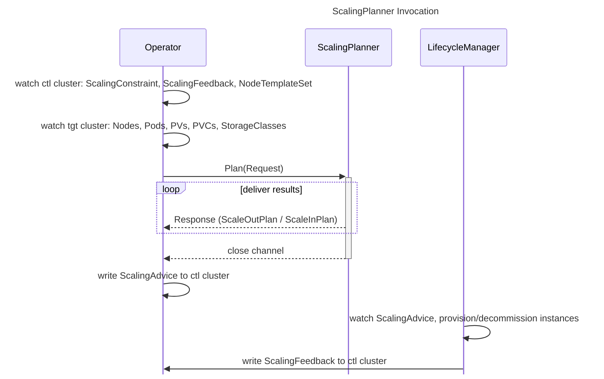
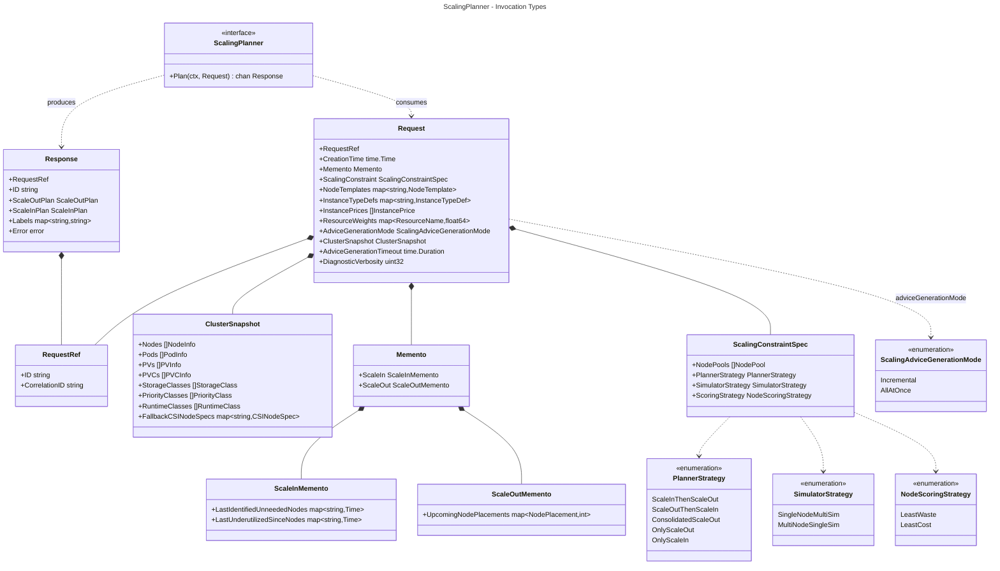
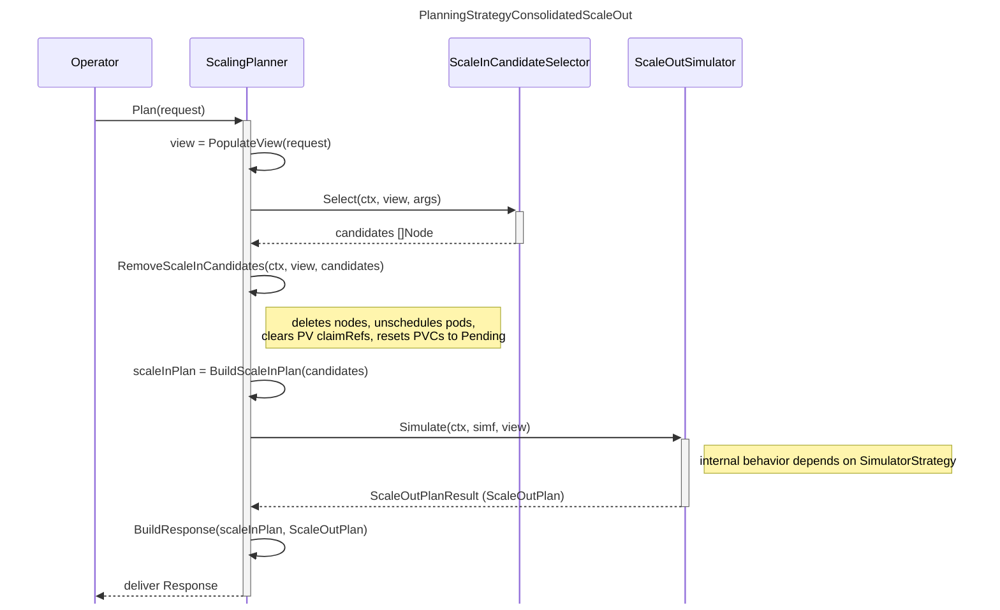
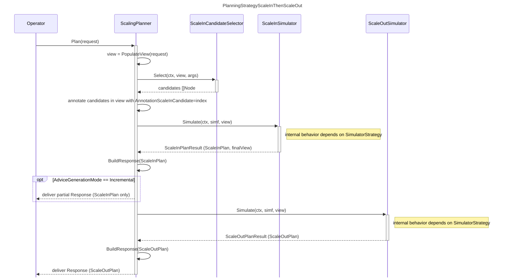
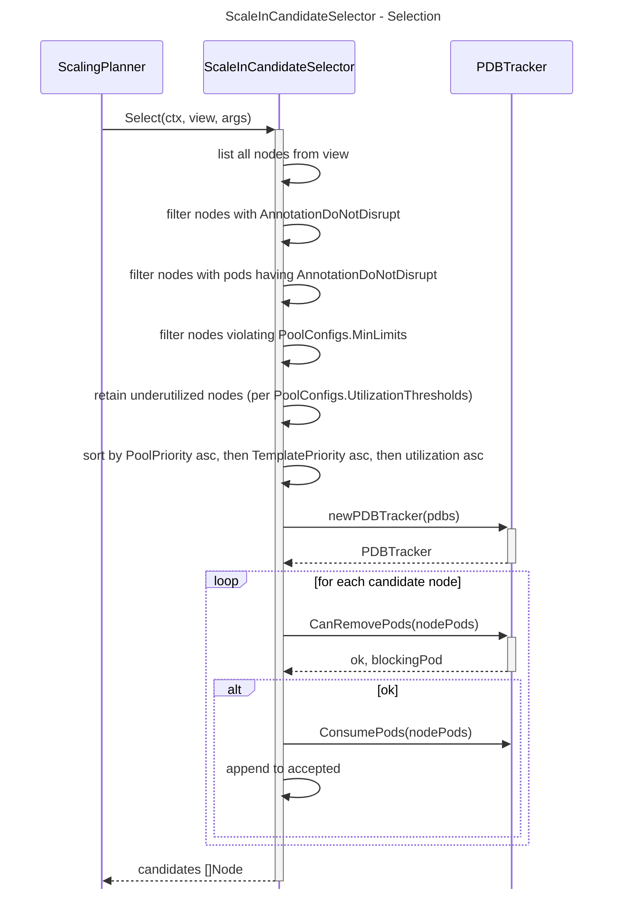
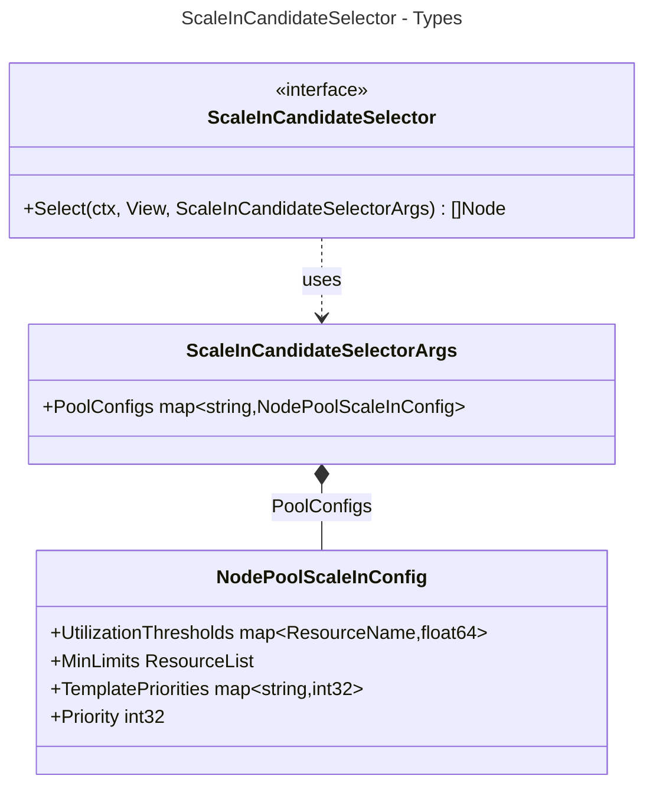
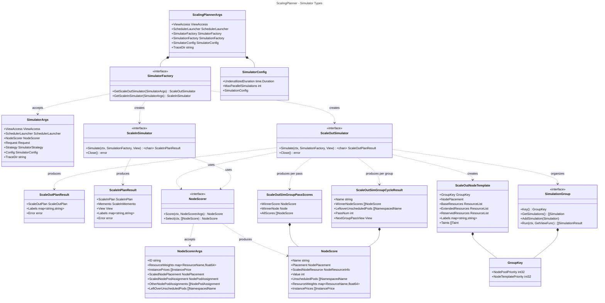
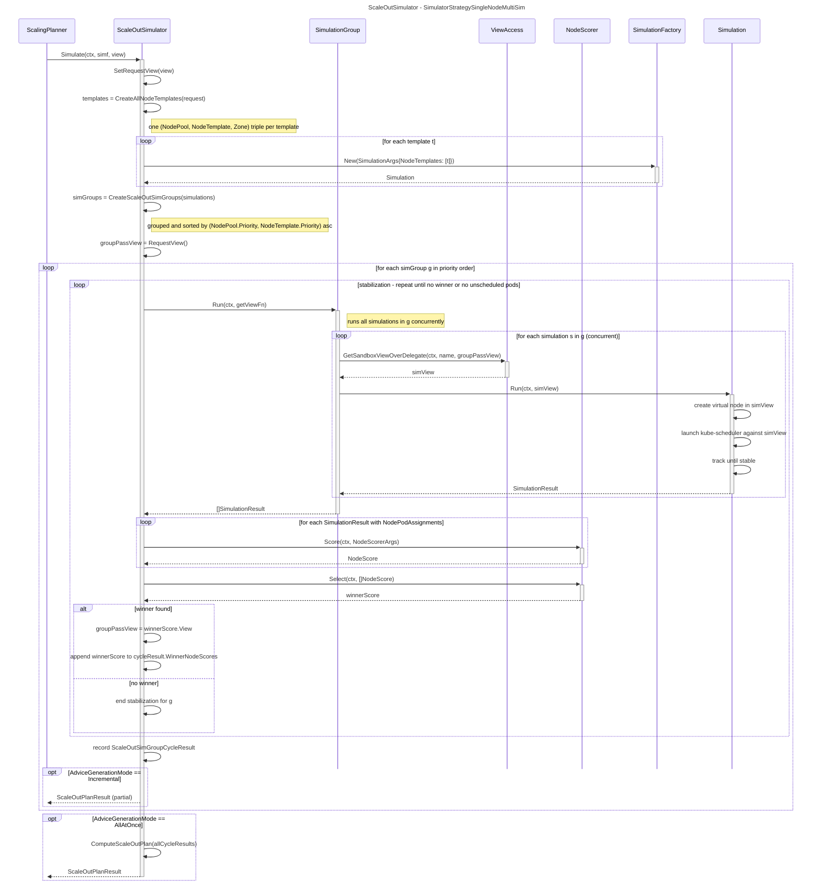

# Scaling Advisor Design 

## High Level Operational View

- `scaling-advisor` is an *advisory controller* that does the following:
  - watches control cluster custom resources: [ScalingConstraint](../api/core/v1alpha1/scalingconstraints.go#L26),[ScalingFeedback](../api/core/v1alpha1/scalingfeedback.go#L29), [NodeTemplateSet](../api/core/v1alpha1/nodetemplateset.go#L15), [InstanceTypeDefSet](../api/core/v1alpha1/instancetypedefset.go#L19)and [InstancePriceSet](../api/core/v1alpha1/instancepriceset.go#L18) and 
  - watches target cluster scheduling-relevant objects: Nodes, Pods, PersistentVolume's, PersistentVolumeClaims, 
    StorageClasses, RuntimeClasses, PriorityClasses, RuntimeClasses, CSINodes, etc
  - builds a [planner Request](../planner/api/types.go#L34), invokes the [ScalingPlanner](../planner/api/types.go#L285), 
    converts the [planner Response](../planner/api/types.go#L74) to [ScalingAdvice](../api/core/v1alpha1/scalingadvice.goL30) resource generated in the control cluster.
- Real scaling actions are executed by an **Lifecycle Manager** (e.g. [machine-controller-manager](github.com/gardener/machine-controller-manager)) that  generally runs in the control cluster: it consumes the `ScalingAdvice`, provisions or decommissions instances, and writes back `ScalingFeedback` object.
- The `scaling-advisor` reads `ScalingFeedback` to pace subsequent advice - it will not produce a new `ScalingAdvice` until the lifecycle-manager has acknowledged the current one via `ScalingFeedback.Spec.AcknowledgedAt`.

## Modules
The scaling-advisor has been structured into several Go modules, some of which are independently reusable.

| Module | Path | Description                                                                                                                                                                                                                                                                                                                                          |
|---|---|------------------------------------------------------------------------------------------------------------------------------------------------------------------------------------------------------------------------------------------------------------------------------------------------------------------------------------------------------|
| `api` | `/api` | Base CRD types and common API constants. Foundation for all other modules.                                                                                                                                                                                                                                                                           |
| `minkapi/api` | `/minkapi/api` | Interface definitions for the minimal in-memory Kubernetes API (MinKAPI).                                                                                                                                                                                                                                                                            |
| `simulation/api` | `/simulation/api` | Interface and type definitions for the simulation subsystem.                                                                                                                                                                                                                                                                                         |
| `planner/api` | `/planner/api` | Interface and type definitions for the planner subsystem, including `ScalingPlanner`, `Request`, and `Response`.                                                                                                                                                                                                                                     |
| `planner/api/helper` | `/planner/api/helper` | Adapter and query helpers that reference both planner and simulation API types (`AsNodeInfo`, `AsPodInfo`, `GetUnscheduledPods`, etc.). Follows the [k8s core/v1/helper] convention: helpers too dependency-heavy for the API package itself live in a sub-package so that lightweight consumers (e.g. `minkapi`) need not pull in `simulation/api`. |
| `common` | `/common` | Shared utilities: node, pod, object, and I/O helpers. Depends only on `api` and `minkapi/api`; higher-level helpers (planner/simulation-aware) live in `planner/api/helper`.                                                                                                                                                                         |
| `minkapi` | `/minkapi` | In-memory Kubernetes API implementation with sandboxed views, used by the scheduler during simulation.                                                                                                                                                                                                                                               |
| `simulation` | `/simulation` | Simulation engine: runs the embedded kube-scheduler against a sandboxed MinKAPI view to produce `SimulationResult`s.                                                                                                                                                                                                                                 |
| `simulation/simvolume` | `/simulation/simvolume` | Simulated PVC/PV binding operations (`BindVolumeClaimsForImmediateMode`, `ProvisionAndBindVolumesForWFFC`, `FinalizeStaticVolumeBindingsForWFFC`). Kept separate from `common/volutil` because it requires `planner/api` error sentinels and `simulation/api` types.                                                                                 |
| `samples` | `/samples` | Test fixtures and scenario generators (pods, PVCs, PVs, storage classes). Used by `simulation` and `planner` tests.                                                                                                                                                                                                                                  |
| `planner` | `/planner` | Core planning logic: `ScaleInSimulator`, `ScaleOutSimulator`, [`ScaleInCandidateSelector`](#scaleincandidateselector), and the default `ScalingPlanner` implementations.                                                                                                                                                                                                          |
| `service` | `/service` | HTTP/gRPC service wrapper (currently a stub) that exposes the planner as a local network endpoint for testing/debugging.                                                                                                                                                                                                                             |
| `operator` | `/operator` | `scaling-advisor` operator binary *(currently a stub - will wire up planner, minkapi, and service)*.                                                                                                                                                                                                                                                 |
| `tools` | `/tools` | CLI utilities (`scadctl`) for generating instance type definitions and pricing data.                                                                                                                                                                                                                                                                 |

[k8s core/v1/helper]: https://pkg.go.dev/k8s.io/kubernetes/pkg/apis/core/v1/helper

## Components

### ScalingPlanner
`ScalingPlanner` is a *functional*, **stateless** component that takes in
`plannerapi.Request` and delivers `plannerapi.Response` on a result channel. The
`ScalingPlanner` is invoked by the operator every time there is a change in the
`ScalingConstraint` or `ScalingFeedback` or the cluster snapshot (nodes, pods,
etc.) changes.

#### Invocation

#### Types

##### Invocation Types

| Type | Purpose |
|---|---|
| `ScalingPlanner` | Interface; entry point: `Plan` returns a channel on which one or more `Response`s are delivered. |
| `Request` | Everything the planner needs: cluster state, constraints, pricing, and cross-invocation memento. |
| `RequestRef` | Stable identity (`ID` + `CorrelationID`) embedded in both `Request` and `Response` for correlation. |
| `Response` | Single delivery on the result channel; carries a partial or final `ScaleOutPlan`/`ScaleInPlan` or a terminal `Error`. |
| `ClusterSnapshot` | Scheduling-relevant cluster state at request time: nodes, pods, volumes, storage/priority/runtime classes. |
| `Memento` | Cross-invocation state passed back into the next `Request` to enable incremental planning. |
| `ScaleInMemento` | Tracks per-node under-utilization timestamps so scale-in is only recommended after sustained under-use. |
| `ScaleOutMemento` | Tracks node placements from prior accepted `ScaleOutPlan`s that are not yet `Ready`, avoiding double-counting. |
| `ScalingConstraintSpec` | Operator-configured policy: node pools, and the three strategy selectors below. |
| `PlannerStrategy` | High-level ordering policy: whether to scale-in first, scale-out first, or consolidate into one pass. |
| `SimulatorStrategy` | Simulation topology: `SingleNodeMultiSim` (one node per sim, pick winner) vs `MultiNodeSingleSim` (scale many nodes in one sim). |
| `NodeScoringStrategy` | Algorithm used to rank candidate scale-out nodes: `LeastWaste` or `LeastCost`. |
| `ScalingAdviceGenerationMode` | `Incremental` delivers partial responses as simulations complete; `AllAtOnce` waits for all. |

#### Planner Strategies 

##### PlanningStrategyConsolidatedScaleOut

`PlanningStrategyConsolidatedScaleOut` identifies scale-in candidate nodes via the [`ScaleInCandidateSelector`](#scaleincandidateselector), removes them from the view directly (without simulation), and then runs scale-out simulation(s) to produce a consolidated scale-in and scale-out plan.

- The `ScalingPlanner` calls `RemoveScaleInCandidates(ctx, view, candidates)` which:
  - Deletes the candidate nodes from the view.
  - Unschedules their pods (clears `pod.Spec.NodeName`).
  - For each PVC bound to a pod on a candidate node: clears `pv.Spec.ClaimRef` and resets the PVC phase to `Pending`, making the storage available for re-binding during scale-out simulation.
- The modified view is passed directly to `ScaleOutSimulator.Simulate`.
- The `ScaleInPlan` in the `Response` is built directly from the candidate list: no scale-in simulation is run.
- Success criteria: the simulation result is acceptable if the set of leftover unscheduled pods after scale-out simulation is a subset of the originally unscheduled pods (prior to invoking the planner).

Advantages:
- Best-fit node selection for pods displaced from underutilized nodes, since all such pods are explicitly unscheduled and compete equally in scale-out simulation.
- More responsive than `ScaleInThenScaleOut`: only scale-out simulations run, which may be optimised to a single simulation depending on `SimulatorStrategy`.

Disadvantages:
- Greater disruption period for pods on scaled-in nodes: they must wait for new scale-out nodes to become ready before being rescheduled.

##### PlanningStrategyScaleInThenScaleOut

> [!NOTE]
> This Strategy will NOT be implemented in first delivery. But documented for posterity.

`PlanningStrategyScaleInThenScaleOut` executes scale-in simulation(s) first to produce scale-in plans, then executes scale-out simulation(s) to produce scale-out plans.

- Pure scale-in simulations involve removing underutilized nodes and verifying that the existing workload on those nodes can be rescheduled onto remaining nodes.
- Pure scale-out simulations involve adding nodes and verifying that unscheduled workload can be placed on them.
- The view produced by the last successful scale-in simulation is passed to the `ScaleOutSimulator`.
- If `Request.AdviceGenerationMode` is `Incremental`, a partial `Response` carrying only the `ScaleInPlan` is delivered to the operator before scale-out begins.

Advantages:
- Explicit scale-in simulation honours PDBs and reschedules existing pods onto already-existing nodes, minimising disruption (no new nodes needed for those pods).
- Better suited to instance quota limits since scale-in runs first.

Disadvantages:
- Prioritising no-disruption over better packing: an underutilized node whose pods cannot move to existing nodes is left in place, even if a new scale-out node would fit them better.
- Scale-out plans are delayed until all scale-in simulations complete, so latency-sensitive workloads waiting for immediate scale-out are affected.

#### ScaleInCandidateSelector

The `ScaleInCandidateSelector` identifies candidate nodes considering annotations, PDBs, utilization thresholds, pool min limits, pool priorities, and `NodeTemplateRef` priorities - without running any simulation involving the `kube-scheduler`. It is invoked by the `ScalingPlanner` before considering either `PlanningStrategyConsolidatedScaleOut` or `PlanningStrategyScaleInThenScaleOut`.

| Field | Purpose |
|---|---|
| `PoolConfigs` | Per-pool configuration keyed by pool name. |
| `NodePoolScaleInConfig.UtilizationThresholds` | Per-resource fractions (0-1); a node is underutilized only if all configured resources are below their threshold. |
| `NodePoolScaleInConfig.MinLimits` | Minimum total allocatable resources for the pool; a candidate is rejected if its removal would drop the pool below this minimum. |
| `NodePoolScaleInConfig.TemplatePriorities` | Priority per node template name within the pool; lower value is preferred for scale-in. |
| `NodePoolScaleInConfig.Priority` | Pool-level priority; lower value is preferred for scale-in over higher-priority pools. |

### Simulators

Simulators are facades that orchestrate one or more `Simulation` runs against sandboxed `minkapi` views to produce scaling plans. 

- The `ScaleOutSimulator` for `single-node-multi-sim`  creates a `ScaleOutNodeTemplate` per `(NodePool, NodeTemplate, Zone)` triple, groups them by priority, and runs stabilization cycles to determine which node placements best absorb unscheduled pods. 
- The `ScaleInSimulator` drives scale-in: it processes annotated candidate nodes sequentially, promoting sandbox views on success to build up a `ScaleInPlan`.
- Simulators delegate pod-to-node scoring to a `NodeScorer` and simulation execution to a `Simulation` obtained via a `SimulationFactory` residing in the `simulation` module. 

#### Types

| Type | Purpose |
|---|---|
| `ScalingPlannerArgs` | Constructor input; wires together the `ViewAccess`, `SchedulerLauncher`, factories, and config the planner depends on. |
| `SimulatorFactory` | Creates `ScaleOutSimulator` and `ScaleInSimulator` instances for a given `SimulatorArgs`. |
| `SimulatorArgs` | Constructor input for simulators: view access, scheduler launcher, node scorer, request, strategy, and config. |
| `ScaleOutSimulator` | Runs scale-out simulations against a sandboxed `View` and streams `ScaleOutPlanResult`s on a channel. |
| `ScaleInSimulator` | Runs scale-in simulations against a sandboxed `View` and streams `ScaleInPlanResult`s on a channel. |
| `ScaleOutPlanResult` | Single delivery from `ScaleOutSimulator.Simulate`; contains a `ScaleOutPlan` or a terminal `Error`. |
| `ScaleInPlanResult` | Single delivery from `ScaleInSimulator.Simulate`; contains a `ScaleInPlan`, updated `ScaleInMemento`, and the post-simulation `View`. |
| `NodeScorer` | Scores and selects the winning simulated node; strategy is determined by `NodeScoringStrategy` in the request. |
| `NodeScorerArgs` | Input to `NodeScorer.Score`: placement, pod assignments, leftover unscheduled pods, pricing, and resource weights. |
| `NodeScore` | Output of `NodeScorer.Score`: numeric score, placement, scaled node resource info, and unscheduled pods. |
| `SimulatorConfig` | Static config: under-utilization duration and max parallel simulations. |
| `ScaleOutNodeTemplate` | A `(NodePool, NodeTemplate, Zone)` triple with full node capacity info; one simulation is created per triple. |
| `GroupKey` | Composite sort key `(NodePoolPriority, NodeTemplatePriority)` used to group and order simulation groups. |
| `SimulationGroup` | A group of `Simulation`s sharing the same `GroupKey`; runs them concurrently and returns all `SimulationResult`s. |
| `ScaleOutSimGroupPassScores` | Scored results of one pass within a group: winner `NodeScore`, winner `Node`, and all scores. |
| `ScaleOutSimGroupCycleResult` | Accumulated result of a group's stabilization cycle: winner node scores, leftover pods, pass count, and next view. |

#### ScaleOutSimulator 

##### SimulatorStrategySingleNodeMultiSim (single-node-multi-sim)

`SimulatorStrategySingleNodeMultiSim` runs one simulation per `(NodePool, NodeTemplate, Zone)` triple. Each simulation scales exactly one virtual node of that triple into a sandbox minkapi view and lets the `kube-scheduler` place pending pods onto it. After all simulations in a priority group complete one pass, the `NodeScorer` picks the winner; that winner's sandbox becomes the base view for the next pass. The group repeats passes until no pods remain unscheduled or no winner is found. The simulator then advances to the next priority group and repeats.

Key concepts:

- **`ScaleOutNodeTemplate`**: a `(NodePool, NodeTemplate, Zone)` triple: one simulation is created per triple.
- **`ScaleOutSimGroup`**: simulations are grouped by `(NodePool.Priority, NodeTemplate.Priority)`. Lower priority value is preferred: groups are processed in ascending priority order.
- **Pass**: one execution of all simulations in a group; each simulation runs concurrently against a sandbox of the current `groupPassView`.
- **Stabilization cycle**: repeated passes of a group until either no unscheduled pods remain or no winner emerges. The winner's sandbox view becomes the `groupPassView` for the next pass.
- **`ScaleOutSimGroupPassScores`**: the scored results of one pass: winner `NodeScore` plus all scores.
- **`ScaleOutSimGroupCycleResult`**: accumulated result of all passes for one group: winner node scores, leftover unscheduled pods, pass count, and the `NextGroupPassView` handed to the next group.

## TODO

- Need sub-section describing `minkapi`
  - The `ScalingAdvisor` leverages a minimal in-memory KAPI (called `minkapi`) to hold cluster snapshot (k8s objects such as existing nodes, pods, volumes, volume-attachments, etc.) of the real cluster.
  - The base `minkapi` offers *in-memory* k8s client implementations for [kuberentes.Interface](https://pkg.go.dev/k8s.io/client-go/kubernetes#Interface) and [dynamic.Interface](https://pkg.go.dev/k8s.io/client-go/dynamic#Interface) 
  - `minkapi` also supports *sandboxed views* and in-memory clients for the sandboxed views which are consumable by the `kube-scheduler`. 
   - The sandbox clients *decorate* the base clients and maintain their own internal state. Changes made by a scheduler instance are limited to its own sandbox and are not propagated to the master data.
- Need sub-section describing `simulation` module